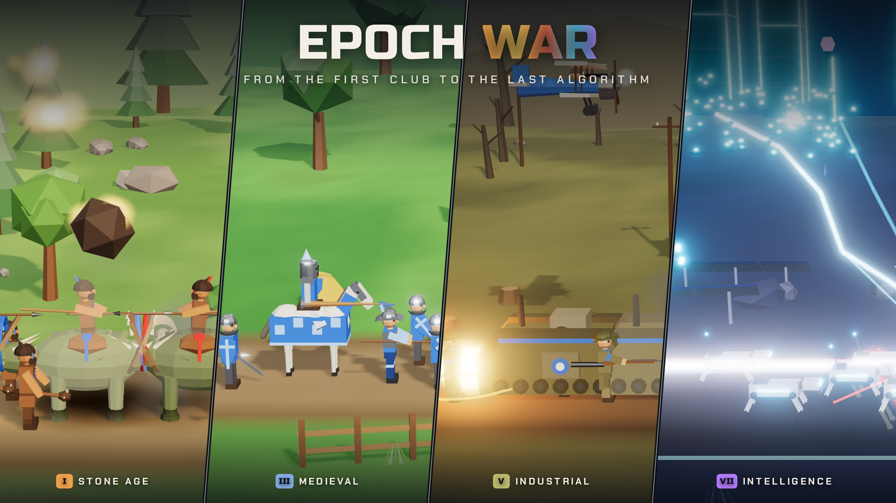
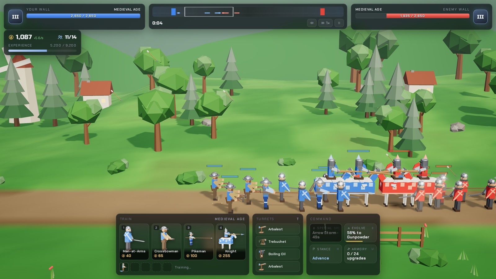
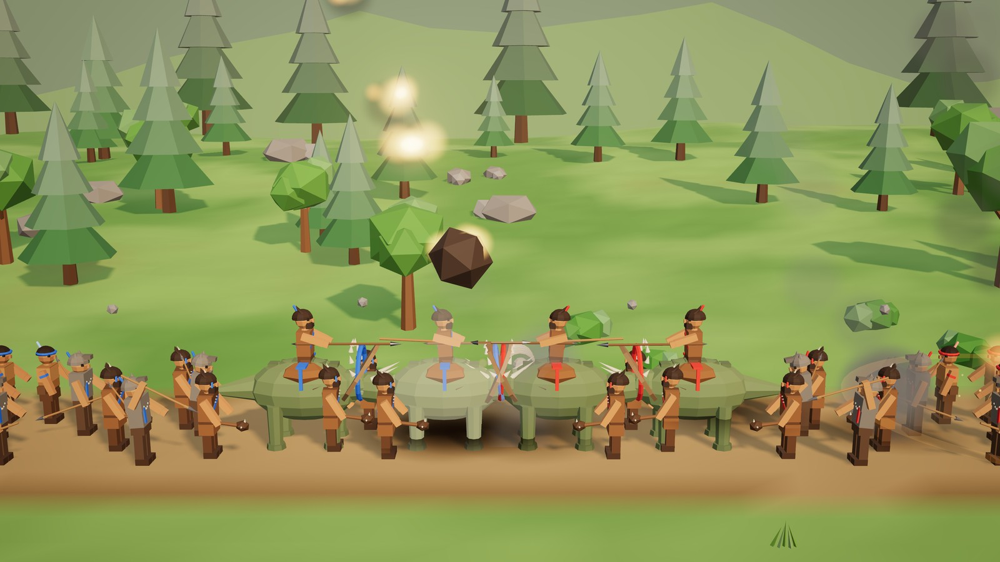
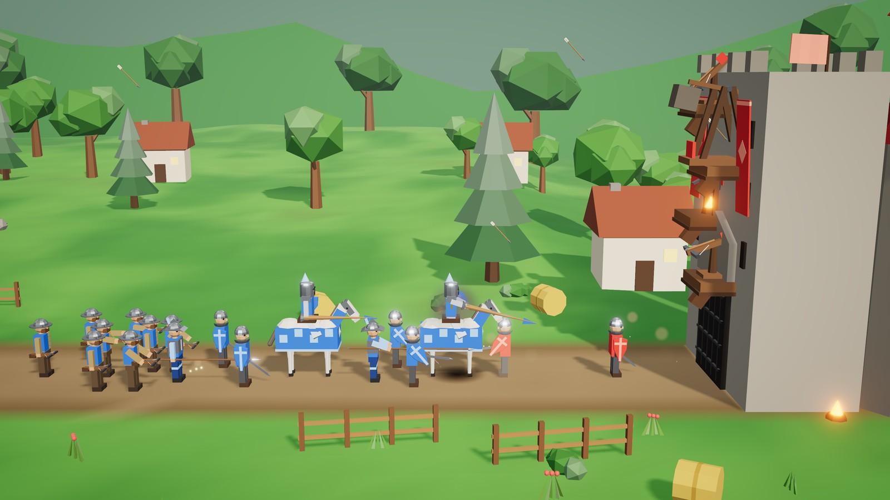
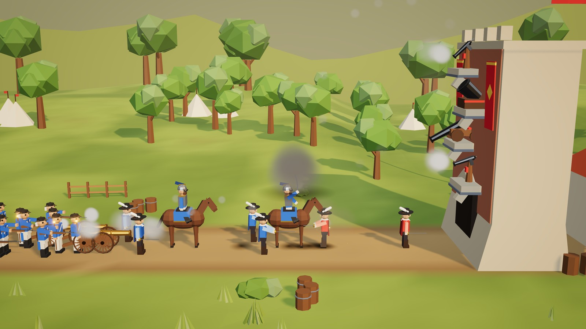
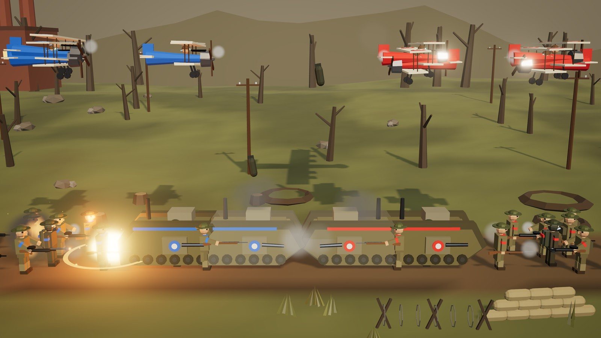
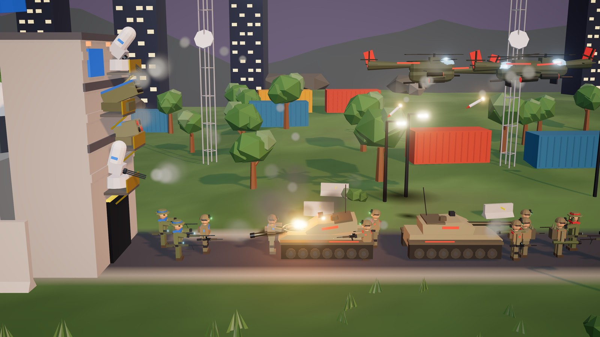
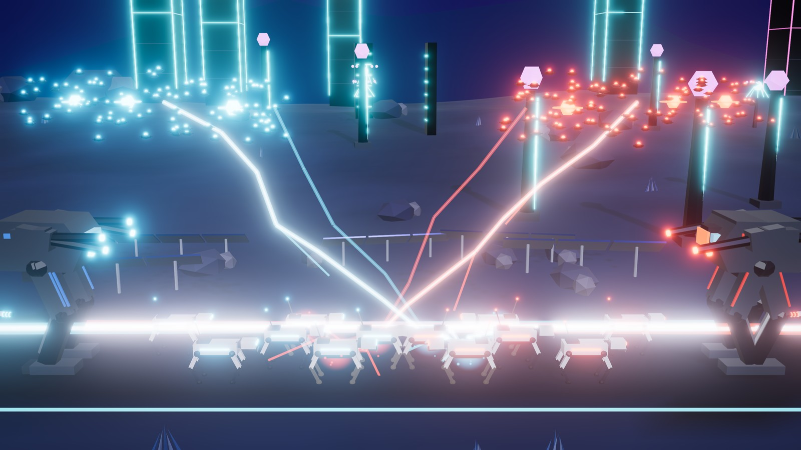

# Epoch War

A 3D lane-battle strategy game in the spirit of the Flash classics **Age of War** and **Age of War 2**. Two walls face each other across a valley. You train troops, build turrets, and evolve through seven ages, from clubs and dinosaurs to robo-hounds, walking mechs and a superintelligence given a body.

**Play it:** https://epoch-war-286937397059.europe-west6.run.app





## What's in it

- **Seven ages**: Stone, Ancient, Medieval, Gunpowder, Industrial, Modern, and the **Age of Intelligence**.
- **32 units**: four per age (the heavy unit has to be unlocked with a building, as in AoW2). The last three ages add an aircraft. The final age has an apex unit, the OMEGA Model.
- **21 turrets and 7 fortresses**. Each fortress has a four-ledge turret tower.
- **7 specials**: Meteor Shower, Wrath of Zeus, Arrow Storm, Rally the Colours, Bomber Run, Drone Swarm, and Override, which hacks enemy units over to your side.
- **The twists** (see [DESIGN.md](DESIGN.md)):
  - A rock-paper-scissors counter system, plus an air layer that melee units can't reach.
  - **Doctrine drafts**: each time you evolve, you pick one of three random perks, roguelite style.
  - Veterancy ranks and an armory with permanent upgrades.
  - A hold-the-line stance.
  - An **adaptive enemy AI** that reads your army and counter-builds. It tells you so in the intel feed.
  - The **Singularity Project**, a win condition in the final age that you race the enemy for.
- **The world evolves**: when a side advances an age, its half of the valley is repainted and re-propped in a wave from its wall. The sky moves from a Stone Age dawn to a neon night.
- **Everything is procedural**. Every model is built in code from low-poly primitives, every animation is procedural, and every sound effect and all the music (a different style per age) are synthesized live with WebAudio. There are no third-party assets.

## Screenshots

| | |
|---|---|
|  |  |
| **Stone Age**: the Meteor Shower special lands on a line of trike riders. | **Medieval**: knights and crossbowmen storm the castle while its turrets fire back. |
|  |  |
| **Gunpowder**: cannon smoke at the walls of a star fort. | **Industrial**: biplanes duel overhead while landships grind together below. |
|  |  |
| **Modern**: CIWS and missile turrets hold off gunships and tanks. | **Age of Intelligence**: mechs, robo-hounds and nano swarms trade lightning. |

## Running it

```bash
npm install
npm run dev        # http://localhost:5180
npm run build      # typecheck + production build into dist/
npm run preview    # serve dist/ on http://localhost:5181
```

The game runs in any recent desktop browser with WebGL2. Graphics quality (low / medium / high) is in Settings.

## How to play

| Key | Action |
| --- | --- |
| `1`–`6` | Train a unit (right-click a card to cancel one) |
| `Space` | Special (aimed specials: then click the battlefield) |
| `T` | Build a turret on the next empty ledge (or click "+ Build turret", or the glowing + on your tower) |
| `E` | Evolve when the XP bar is full |
| `H` | Toggle stance: advance / hold the line |
| `U` | Armory |
| `X` | Start the Singularity Project (final age) |
| `A` `D` / arrows / screen edges / drag | Scroll; mouse wheel zooms; click the minimap to jump |
| `P` / `Esc` | Pause · `F` game speed (1×/2×/3×) · `M` mute |

Kills pay gold and experience. Fill the experience bar to evolve. Your wall falls when its health bar empties, and so does theirs.

## Development

```bash
npm test                     # simulation rule checks (tools/rules-test.ts)
npm run bench -- 10 veteran  # headless AI-vs-AI wars: game length, age timings, win rates
npm run bench -- 12 general veteran   # difficulty A vs difficulty B
npm run shoot -- "/?gallery=6" shots/g6.png   # screenshot the dev server (needs Playwright's headless shell)
```

The simulation (`src/sim`) has no rendering dependencies and runs headless, which is how the balance numbers were tuned.

With the dev server running, `tools/dev/` has browser scripts too: `smoke.mjs` plays a war through the real UI, `soak.mjs` fast-forwards a full AI-vs-AI war through all seven ages checking for errors and leaks, `special.mjs <age>` photographs a special, and `audio.mjs` runs a battle with sound on. Headless software rendering manages only a few frames per second, so the simulation runs in slow motion there. That is expected.

Dev-only URL flags (ignored in production builds):

| Flag | Effect |
| --- | --- |
| `?gallery=<age>` | Model gallery: every unit of an age, both teams, cycling walk → attack → idle (`&die` for deaths, `&turrets` for the age's turrets firing) |
| `?play=<difficulty>` | Skip the menu and start a war (`recruit`, `veteran`, `general`, `impossible`) |
| `?autopilot` | An AI plays your side too |
| `?age=<n>` · `&turrets` | Jump both sides to an age (and fill their turret ledges) |
| `?warmup=<s>` | Fast-forward the simulation before the first frame |
| `?attract` · `?nohud` | Menu battle without the menu · hide the HUD |
| `?cam=<x>` · `?dist=<d>` · `?quality=low` | Camera position / zoom / graphics preset |

### Layout

```
src/
  sim/        simulation: world, AI, data for ages/units/turrets/doctrines, counter table
  render/     three.js: renderer + post, camera, terrain/sky/scenery, battle view
    models/   procedural units, mounts, machines, turrets, fortresses, gear
    effects/  particles, projectiles, health bars, beams/lightning/rings/decals
  ui/         HUD, menus, icons, styles
  audio/      synthesized sound effects and generative music
tools/        rules tests, balance bench, screenshot tools
```

## Deploying (Google Cloud Run)

The `Dockerfile` builds the static site and serves it with nginx on port 8080, with
security headers (CSP, no framing) set in `nginx.conf`:

```bash
gcloud run deploy epoch-war --source . --region europe-west6 --allow-unauthenticated --port 8080 --max 3 --max-instances 3
```

`--max 3` caps the service at three instances — plenty for static files, and it
bounds what a flood of requests can cost.

Any static host works too: upload `dist/` after `npm run build`.

## Credits

Inspired by *Age of War* (2007) and *Age of War 2* by Louissi / Max Games. This is a fan reimagining; it uses none of their code, art or sound.
